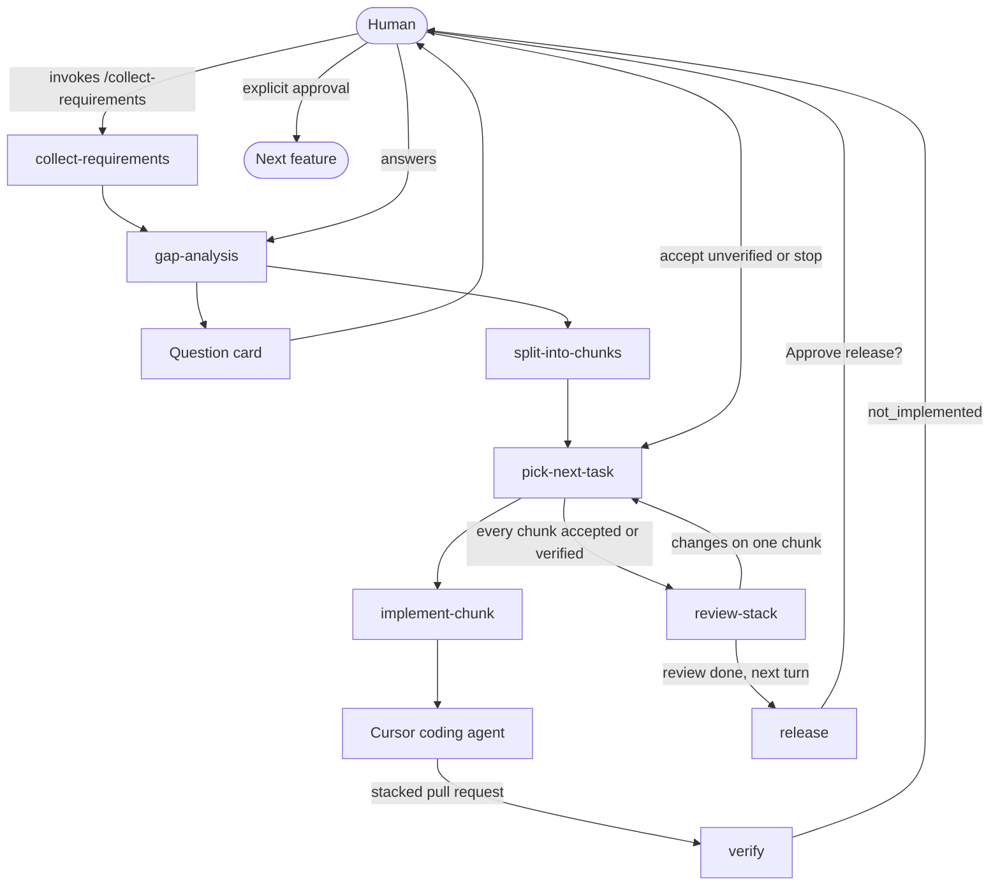

# fstack

fstack is a shareable Cursor plugin for a small team of agents that delivers one software feature end to end. The human starts requirements, reviews the stack once, and approves release. An orchestrator plans the work and launches Cursor coding agents. A verifier returns a verdict from the spec and the patch.

The name is short for feature stack. Coding runs in Cursor. Model names in the config are Cursor models. Legal statuses and transitions live in [`state/transitions.yaml`](state/transitions.yaml). Skills follow that table. There is no command-line runner.

## Install

This repository is the plugin. The Cursor manifest is `.cursor-plugin/plugin.json`. The root `plugin.json` is the Agent Plugins manifest, so the skills also load in hosts that follow that standard. Rules and agents are Cursor plugin components.

Local install:

1. Copy this repository to `~/.cursor/plugins/local/fstack`. Cursor skips a symlink that points outside that folder, so copy the files.
2. Reload the window.
3. Open Customize and confirm the fstack skills, the orchestrator, verifier, and advisor agents, and the human-gates rule.

From a team marketplace, install **fstack** from Customize after an admin imports this repository. Publishing to the public Cursor marketplace is a separate submission at [cursor.com/marketplace/publish](https://cursor.com/marketplace/publish). This repo stays a single plugin at the root, with no marketplace manifest, until an import shows that one is required.

## Quick start

In the product repository, with the plugin installed:

1. Invoke `/setup-project`. This writes `fstack.yaml` when it is missing, ignores `.fstack/`, and puts feature files in the Cursor agent store when `/cursor/stores/self` is mounted. Otherwise it uses `.fstack/features/`.
2. Invoke `/collect-requirements` and describe the feature. Confirm the requirements file when asked. This is the only way requirements collection starts.
3. Answer the question card from gap analysis. If nothing is open, the orchestrator says so and continues.
4. The orchestrator splits the feature into stacked chunks. Plan approval waits only when `plan_review` is `approve`. The shipped value is `notify`, so coding starts after the plan is shown.
5. Each chunk is implemented by a Cursor coding agent. The flow then calls `verify`. That skill is a stub: it returns `not_implemented` and does not check the patch. You choose `accept_unverified` or `stop`. The choice is logged. The stack does not continue until you do.
6. Review the stacked pull requests when asked. That question does not approve release.
7. Answer the later release question. The stack is merged only after you explicitly approve the effect and the shas that question names.
8. After release, the orchestrator moves to the next open feature. A new feature still starts with `/collect-requirements`.

A later session resumes with `/fstack-status` and the feature slug.

## Flow



`build-context` still writes `prompts/<chunk-id>/a<attempt>/verify.md` before `verify` is called. The skill does not use that prompt to judge the chunk. It returns `verdict: not_implemented` and the message `Verification is not implemented yet, so these changes cannot be verified.` The orchestrator sends that sentence through `tldr` and leaves the chunk in `awaiting_verification_decision`. `accept_unverified` is logged and is not a pass. `stop` ends the feature and leaves pull requests open.

The prompt shape the stub will someday use is unchanged: the orchestrator builds it from `git diff <base_sha>...<head_sha>`, with the spec, the acceptance criteria, the out-of-scope section, and the patch. It does not include the feature directory, a pull request URL, or implementer notes. The intended verifier runs in a clean checkout of that head. That design is the TODO in the `verify` skill and in [stubs/enforcement.md](stubs/enforcement.md).

`tldr` rewrites messages to the human. Question ids, options, the release command, shas, and pull request URLs stay verbatim.

`planner_review` critiques gap analysis and the chunk split. `verify_tiebreak` is reserved for a future disputed verdict. The stub never asks for it, because it does not judge the chunk. Both advisors are read-only. A feature allows six advisor calls, and two of those are reserved for the tie-break. The tie-break is advice. The orchestrator decides or escalates.

## Configuration

`fstack.yaml` sits at the product repository root. Paths inside it are relative. Resolved Cursor slugs are written to `.fstack/resolved.yaml`, which is gitignored, so two people do not overwrite the shared file.

| Key | Shipped value | Meaning |
| --- | --- | --- |
| `state.backend` | `cursor-store` | Feature files live in the Cursor agent store |
| `state.fallback` | `.fstack/features` | Used only when no store is mounted. Gitignored. Stays on one machine |
| `plan_review` | `notify` | Show the plan and continue. `approve` waits for a yes |
| `review.mode` | `end_of_stack` | One human review for the stack, then one release question |
| `verify.max_failures_before_escalation` | `2` | Counted with `attempts_since_decision`, using `>=` |
| `release.command` | empty | An approved release merges the stack and stops |

`models.opus` and `models.argon` are match prefixes and an effort list, in preference order. setup walks that list against the slugs this Cursor session can use. A missing family becomes `inherit`, the parent Cursor model.

The advisor block keeps the original fields and adds a fallback:

```yaml
advisors:
  planner_review:
    model: opus        # e.g. Claude Opus 5.5 in Cursor
    when: [gap-analysis, split-into-chunks]
  verify_tiebreak:
    model: argon       # Gemini 4 Argon in Cursor
    when: [verifier-disputed]
    fallback: [opus]
    must_differ_from: verifier
  max_calls_per_feature: 6
  reserve:
    verify_tiebreak: 2
  fallback:
    - runtime: claude-cli
      command: claude
      model: opus
      enabled: true
```

`verify_tiebreak.fallback` is another Cursor model to try inside Cursor. `advisors.fallback` is a local CLI used only when Cursor cannot start the advisor, for example when the account has no credits for that model. The shipped entry is the Claude Code CLI. setup checks that `claude` is on `PATH` and signed in, and it does not read or print tokens. A local CLI runs under the user's own subscription terms.

If the tie-break would use the same model as the verifier, including when both are `inherit`, the orchestrator skips it and asks the human. That independence rule is not a credit failure, so it does not switch to the local CLI.

Human gates stay fixed: merge, release, and outward messages `require_approval`, and `collect_requirements` `manual_only`. setup stops when a config weakens them. Only a human quote of yes, approve, or approved counts, and only for the question id that was asked.

Roles name an agent and a model. They do not list skills. The agent file is the skill list. The parent that launches a subagent passes the model from the resolved file in the state root.

`implementer.runtime` ships as `cloud`. setup sets `local_worktree` in the resolved file when this session cannot start a cloud agent that opens a pull request onto a non-default base. The implementer still gets the chunk spec in the launch prompt. setup does not create a worktree for fstack state.

## Where state lives

`state.backend` is `cursor-store`. setup uses `/cursor/stores/self` when that path is a directory or a symlink to one. Feature files go in `fstack/features/<name>/` inside the store, not in the store's `artifacts/` directory. `artifacts/` is a separate published bucket in this environment, and fstack does not write skill outputs there.

Another agent can read that tree only when it is given the store id and `/cursor/stores/<id>` is mounted for it. fstack does not grant that access. The coding agent does not need it: the chunk spec is in the launch prompt. If the mount is missing, do not wait and do not look in GitHub.

When `/cursor/stores/self` is not mounted, setup says so and uses `.fstack/features/<name>/`. setup puts `.fstack/` in `.gitignore`. That copy stays on one machine. `/fstack-status` reads the store first, then this folder.

```
fstack/features/<name>/
  feature.yaml
  requirements.md
  questions.md
  plan.md
  decisions.md
  advisors.md
  advisors/inputs/
  advisors/outputs/
  events/<nnnn>-<event>.yaml
  chunks/<NN-slug>.md
  prompts/<NN-slug>/a<attempt>/<action>.md
  verification/<NN-slug>/a<attempt>.yaml
  diffs/<NN-slug>/a<attempt>.diff
```

The only files fstack publishes are pull requests: a branch of code changes and a short description of that change.

What this environment confirmed: `/cursor/stores/self` is the current agent's store, ordinary file tools read and write it, and a store id mounts at `/cursor/stores/<id>` on first access when the agent is authorized. What is not confirmed: that every Cursor surface mounts this path, that a later cloud-agent run remounts the same id, how long files outside `artifacts/` are kept, or a public API for sharing a store. Those gaps are stubbed as "use the mount when it is there; otherwise use the local folder; do not invent a sync step."

## Workspace

The tree above is the feature workspace. It is not a git branch.

A chunk id is `NN-slug`. Status values and the events that change them are only those in [`state/transitions.yaml`](state/transitions.yaml).

## Skills

| Skill | Who invokes it | What it does |
| --- | --- | --- |
| `setup-project` | Human, or the orchestrator when config is missing | Copies templates, resolves models, records runtime |
| `collect-requirements` | Human, `/collect-requirements` only | Writes the requirements file, then hands off to the orchestrator |
| `gap-analysis` | Orchestrator | Sends a question card, or records that nothing is open |
| `split-into-chunks` | Orchestrator | Writes the stack and follows `plan_review` |
| `pick-next-task` | Orchestrator | Applies the next-rule list once |
| `implement-chunk` | Orchestrator | Hands off one chunk and records the agent id first |
| `verify` | Verifier, at the same point in the flow | Returns `not_implemented` and does not judge the chunk |
| `build-context` | Orchestrator, before an action | Writes the per-attempt prompt |
| `tldr` | Before a human-facing message | Short prose, verbatim decisions |
| `advisors` | Gap analysis, split, one dispute per attempt | Read-only critique. A local CLI fallback counts toward the same cap |
| `escalate` | Orchestrator | Stops for retry, accept, a spec change, or stop |
| `review-stack` | Orchestrator, after every chunk is verified | Asks for review and waits |
| `release` | Orchestrator, after review | Asks, then merges only the approved shas |
| `fstack-status` | Human or a fresh session | Reads saved state and routes a reply |

## What is not enforced yet

[stubs/enforcement.md](stubs/enforcement.md) describes verification, the approval record, the merge and release steps, and a shell hook that should refuse a merge without a matching approval. None of that runs. `verify` returns `not_implemented`. The release skill is the procedure the orchestrator follows by hand. `hooks.json` is absent so a stub is not loaded as if it enforced the gate.

## Adding a bot or a skill

Add a skill by creating `skills/<name>/SKILL.md`. The frontmatter `name` matches the folder. `description` says what it does and when to use it. Set `disable-model-invocation: true` when it must run only from an explicit `/` invocation.

Add a bot by creating `agents/<name>.md` with `name` and `description`, then a `roles` entry in `fstack.yaml` with `agent` and `model`. Put the skills it follows in the agent file. A read-only plugin agent sets `permissionMode: readonly`. When the bot needs a prompt, add `templates/prompts/<action>.md` and name the action in `build-context`. New statuses and events go in `state/transitions.yaml` first.

Run `python3 scripts/validate_plugin.py` after the edit. It checks the manifest, the transition table, the config, the template tokens, and that each event is named by its skill.

## License

MIT. See [LICENSE](LICENSE).
