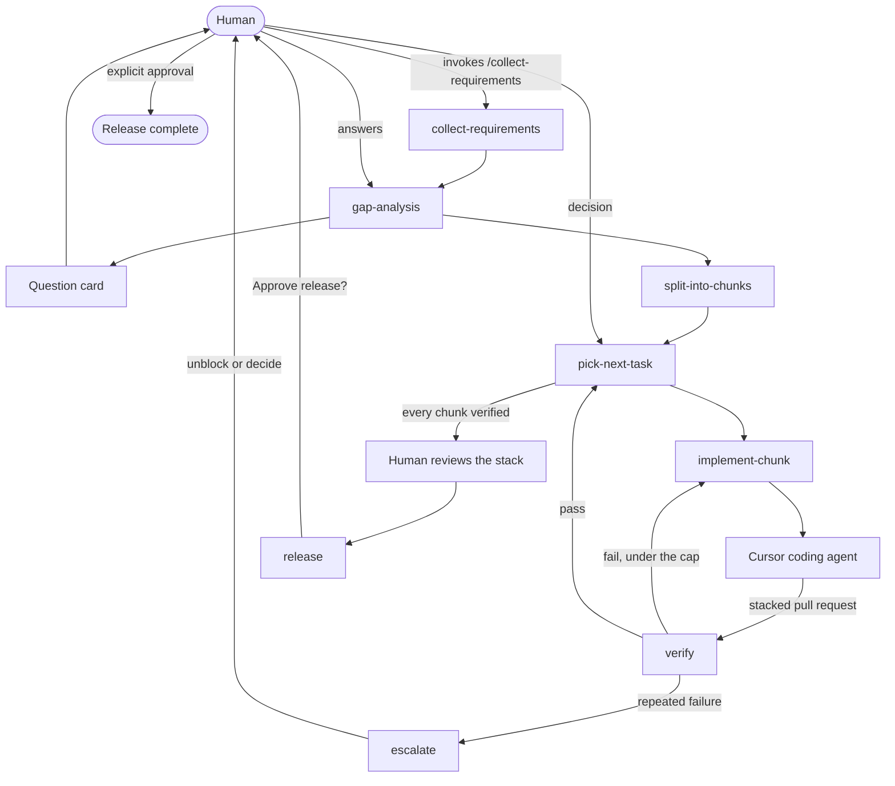

# fstack

fstack is a shareable Cursor plugin for a small team of agents that delivers one software feature end to end. The human starts requirements and approves release. An orchestrator plans the work and launches Cursor coding agents. A verifier checks each chunk from the spec and the diff.

The name is short for feature stack. Coding runs in Cursor. Model names in the config are Cursor models.

## Install

This repository is the plugin. The Cursor manifest is `.cursor-plugin/plugin.json`. The root `plugin.json` is the Agent Plugins manifest so the skills also load in hosts that follow that standard. Rules and agents are Cursor plugin components.

Local install:

1. Copy this repository to `~/.cursor/plugins/local/fstack`. Cursor skips a symlink that points outside that folder, so copy the files.
2. Reload the window.
3. Open Customize and confirm the fstack skills, the orchestrator and verifier agents, and the human-gates rule.

From a team marketplace, install **fstack** from Customize after an admin imports this repository. Publishing to the public Cursor marketplace is a separate submission at [cursor.com/marketplace/publish](https://cursor.com/marketplace/publish).

## Quick start

In the product repository, with the plugin installed:

1. Invoke `/setup-project`. This writes `fstack.yaml` when it is missing, checks the model names, and creates the `features/` workspace.
2. Invoke `/collect-requirements` and describe the feature. This is the only way requirements collection starts. Confirm the written requirements when asked.
3. Answer the question card from gap analysis.
4. The orchestrator splits the feature into stacked chunks, hands them one at a time to a Cursor coding agent, and asks the verifier to check each pull request.
5. Review the stacked pull requests.
6. Answer the release question. The stack is merged only after you explicitly approve the effect the question names.

## Flow



Two helpers run across that flow. `build-context` writes a prompt for the action into `features/<name>/prompts/` before the action runs. The verify prompt carries the spec, the acceptance criteria, and the diff, and it leaves implementer notes out. `tldr` rewrites every question card, escalation, review request, and status report into a short plain message before the human sees it.

`planner_review` critiques gap analysis and the chunk split. `verify_tiebreak` critiques a disputed verdict. Both are read-only Cursor runs, and a feature stops at six advisor calls.

## Configuration

`fstack.yaml` sits at the root of the product repository. Paths inside it are relative to that file. `setup-project` rejects an absolute workspace path.

Roles:

| Role | Who runs it | Job |
| --- | --- | --- |
| `orchestrator` | `agents/orchestrator.md` | Plans, splits, hands off chunks, reports to the human |
| `verifier` | `agents/verifier.md` | Judges a chunk without implementer notes |
| `implementer` | A Cursor coding agent | Implements one chunk and opens a stacked pull request |

`model: inherit` keeps the Cursor model of the parent chat. `opus` and `argon` are short names. `setup-project` maps them onto slugs it can see in the current session and writes the slugs under `models.resolved`. The advisors block keeps the short names. When a family is not available, the resolved value becomes `inherit` and the reason is stored under `models.fallbacks`.

Shipped advisor block:

```yaml
advisors:
  planner_review:
    model: opus        # e.g. Claude Opus 5.5 in Cursor
    when: [gap-analysis, split-into-chunks]
  verify_tiebreak:
    model: argon       # Gemini 4 Argon in Cursor
    when: [verifier-disputed]
  max_calls_per_feature: 6
```

Human gates in the same file:

| Key | Value | Meaning |
| --- | --- | --- |
| `merge` | `require_approval` | A pull request is merged only after an explicit approval |
| `release` | `require_approval` | Release runs only after an explicit approval of the stated effect |
| `outward_messages` | `require_approval` | Mail, chat, and comments outside this conversation wait for approval of that text |
| `collect_requirements` | `manual_only` | `/collect-requirements` is the only trigger |

`setup-project` restores these values when a config has weakened them. `verify.max_failures_before_escalation` is `2`. `release.command` is empty until the project names a production command. An empty command means an approved release merges the stack and stops there.

## Workspace

Per-feature state lives under `workspace` from the config, shipped as `features/`.

```
features/<name>/
  requirements.md
  questions.md
  plan.md
  decisions.md
  advisors.md
  chunks/
    01-<slug>.md
  prompts/
    verify.md
  verification/
    01-<slug>.md
```

Templates for those files are in `templates/feature/` and `templates/prompts/`. `collect-requirements` copies the feature templates when the human starts a feature. `build-context` fills a prompt template on each action.

Chunk status values are `planned`, `implementing`, `in_review`, `verified`, `failed`, and `escalated`. The first chunk is based on the repository default branch. Each later chunk is based on the previous chunk's branch. v0.1 implements one chunk at a time.

## Skills

| Skill | Who invokes it | What it does |
| --- | --- | --- |
| `setup-project` | Human, or the orchestrator when config is missing | Writes config, checks models, creates the workspace |
| `collect-requirements` | Human, `/collect-requirements` only | Writes `requirements.md` and then starts gap analysis |
| `gap-analysis` | Orchestrator | Sends a question card and waits |
| `split-into-chunks` | Orchestrator | Writes the stacked plan and asks `planner_review` |
| `pick-next-task` | Orchestrator | Chooses the one next chunk, or release |
| `implement-chunk` | Orchestrator | Hands the chunk to a Cursor coding agent |
| `verify` | Verifier | Pass, fail, or disputed, from spec and diff |
| `build-context` | Any action | Writes `prompts/<action>.md` |
| `tldr` | Before a human-facing message | Short, plain rewrite |
| `advisors` | Gap analysis, split, disputed verify | Read-only critique, capped per feature |
| `escalate` | Verifier or orchestrator | Stops and asks the human to unblock or decide |
| `release` | Orchestrator, after every chunk is verified | Asks, then merges only with an explicit approval |

## Adding a bot or a skill

Add a skill by creating `skills/<name>/SKILL.md`. The frontmatter `name` matches the folder. `description` says what it does and when to use it. Set `disable-model-invocation: true` when the skill must run only from an explicit `/` invocation, the way `collect-requirements` does.

Add a bot by creating `agents/<name>.md` with `name` and `description` frontmatter, then a `roles` entry in `fstack.yaml` that lists the skills that bot follows. Link those skills from the agent file. When the new work needs a prompt file, add `templates/prompts/<action>.md` and name the action in `skills/build-context/SKILL.md`.

Register a new advisor next to the existing ones with a `model` and a `when` list. It shares `max_calls_per_feature`.

Run `python3 scripts/validate_plugin.py` after the edit. It checks the manifest, the skill frontmatter, the advisor block, the workspace templates, and the cross-references.

## License

MIT. See [LICENSE](LICENSE).
