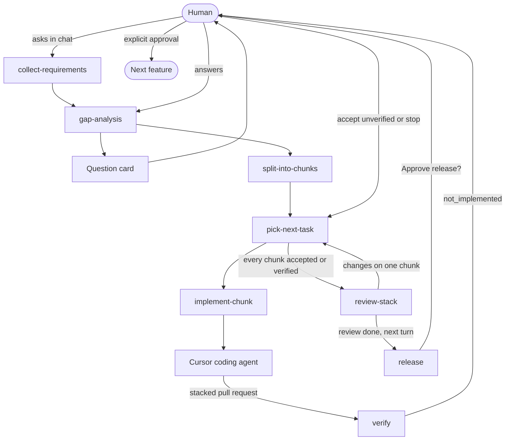

# fstack

fstack is a way to deliver one software feature with a small team of bots. You chat with the Orchestrator. It keeps the feature in Notion, asks you with question cards, and launches a Cursor cloud agent for each chunk. A Verifier and an Advisor are separate bots it messages. You review the stacked pull requests once, then approve release.

The name is short for feature stack. Statuses and transitions live in [`state/transitions.yaml`](state/transitions.yaml). Skills follow that table. There is no command-line runner. Grok Bot is the host these skills are written for. A Cursor plugin install is a secondary option at the end of this file.

## Install

Create three bots from the configs in [`bots/`](bots/) and connect Notion and GitHub on the account that will run them.

1. In Grok Bot, choose New Bot. Name it **Fstack Orchestrator**. In the first message, paste the persona and instructions from [`bots/orchestrator.yaml`](bots/orchestrator.yaml) and ask it to remember them.
2. Tell that bot: "Follow the sync-bot-config skill. The config file is bots/orchestrator.yaml." It copies the skills from this repository, sets its profile, and saves its routines. The first run is the bootstrap. The weekly routine keeps it current.
3. Repeat for [`bots/verifier.yaml`](bots/verifier.yaml) and [`bots/advisor.yaml`](bots/advisor.yaml). Use the profile `name` in each file. Do not invent a platform id.
4. Connect Notion and GitHub when the Orchestrator shows a connect card. The Verifier and Advisor do not need those connectors. Their inputs arrive as messages.
5. Schedules use the timezone in Grok Bot settings under Bot. The five cron fields do not name a zone.

## Quick start

Chat with the Orchestrator. Do not start a feature from another bot.

1. Ask it to set up fstack for the product repository. It writes `fstack.yaml` if needed, ignores `.fstack/` for machine config, and connects Notion. You approve the project page and databases before any schema is created.
2. Ask it to start a feature and describe what you want. That request is the only way requirements collection starts. Confirm the requirements page when the question card asks.
3. Answer the gap-analysis card. If nothing is open, the Orchestrator says so and continues.
4. It splits the feature into stacked chunks. Plan approval waits only when `plan_review` is `approve`. The shipped value is `notify`, so coding starts after the plan is shown.
5. For each chunk it launches one Cursor cloud agent, stacked on the previous branch. When the run finishes, the Orchestrator is revived with the branch, the pull request, and the report. It messages the Verifier. Verification is a stub, so you get a card: accept the chunk unverified, or stop. That choice is saved in Notion. The stack does not continue until you answer.
6. Review the stacked pull requests when the card asks. That card does not approve release.
7. Answer the later release card. The stack is merged only after you approve the effect and the shas that card names.
8. After release, the Orchestrator proposes lessons. They are written to Notion only if you approve. Then it can start the next feature, and only when you ask.

A later chat with the same Orchestrator resumes from Notion. Ask where the feature stands.

## Cursor plugin

The same skills also load as a Cursor plugin. This is not required for Grok Bot.

The Cursor manifest is `.cursor-plugin/plugin.json`. The root `plugin.json` is the Agent Plugins manifest. To try it inside Cursor, copy this repository to `~/.cursor/plugins/local/fstack`, reload the window, and confirm the skills in Customize. A team marketplace install is a separate step. Cursor skips a symlink that points outside that folder, so copy the files.

In Cursor, asking in chat is still how a feature starts. A slash command is only one way to ask.

## Flow



`build-context` writes a Notion child page named `prompt verify a<attempt>` on the chunk before `verify` is called. The skill does not use that page to judge the chunk. It returns `verdict: not_implemented` and the message `Verification is not implemented yet, so these changes cannot be verified.` The orchestrator sends that sentence through `tldr` and leaves the chunk in `awaiting_verification_decision`. `accept_unverified` is logged and is not a pass. `stop` ends the feature and leaves pull requests open.

The prompt shape the stub will someday use is unchanged: the orchestrator builds it from `git diff <base_sha>...<head_sha>`, with the spec, the acceptance criteria, the out-of-scope section, and the patch. It does not include a Notion workspace link, a pull request URL, or implementer notes. The intended verifier runs in a clean checkout of that head. That design is the TODO in the `verify` skill and in [stubs/enforcement.md](stubs/enforcement.md).

`tldr` rewrites messages to the human. Question ids, options, the release command, shas, and pull request URLs stay verbatim.

`planner_review` critiques gap analysis and the chunk split. `verify_tiebreak` is reserved for a future disputed verdict. The stub never asks for it, because it does not judge the chunk. Both advisors are read-only. A feature allows six advisor calls, and two of those are reserved for the tie-break. The tie-break is advice. The orchestrator decides or escalates.

## Configuration

`fstack.yaml` sits at the product repository root. Paths inside it are relative. Resolved Cursor slugs are written to `.fstack/resolved.yaml`, which is gitignored, so two people do not overwrite the shared file.

| Key | Shipped value | Meaning |
| --- | --- | --- |
| `state.backend` | `notion` | Feature records live in the user's Notion workspace |
| `memory.backend` | `notion` | Decisions, corrections, preferences, conventions, and lessons |
| `memory.instructions_version` | `0.0.6` | Sent on every Notion MCP call |
| `plan_review` | `notify` | Show the plan and continue. `approve` waits for a yes |
| `review.mode` | `end_of_stack` | One human review for the stack, then one release question |
| `verify.max_failures_before_escalation` | `2` | Counted with `attempts_since_decision`, using `>=` |
| `release.command` | empty | An approved release merges the stack and stops |

`models.opus` and `models.argon` are match prefixes and an effort list, in preference order. setup walks that list against the slugs this Cursor session can use. A missing family becomes `inherit`, the parent Cursor model.

The advisor block keeps the original fields and adds a fallback:

```yaml
advisors:
  planner_review:
    model: opus        # e.g. Claude Opus 5.5 in Cursor
    when: [gap-analysis, split-into-chunks]
  verify_tiebreak:
    model: argon       # Gemini 4 Argon in Cursor
    when: [verifier-disputed]
    fallback: [opus]
    must_differ_from: verifier
  max_calls_per_feature: 6
  reserve:
    verify_tiebreak: 2
  fallback:
    - runtime: claude-cli
      command: claude
      model: opus
      enabled: true
```

`verify_tiebreak.fallback` is another Cursor model to try inside Cursor. `advisors.fallback` is a local CLI used only when Cursor cannot start the advisor, for example when the account has no credits for that model. The shipped entry is the Claude Code CLI. setup checks that `claude` is on `PATH` and signed in, and it does not read or print tokens. A local CLI runs under the user's own subscription terms.

If the tie-break would use the same model as the verifier, including when both are `inherit`, the orchestrator skips it and asks the human. That independence rule is not a credit failure, so it does not switch to the local CLI.

Human gates stay fixed: merge, release, and outward messages `require_approval`, and `collect_requirements` `manual_only`. setup stops when a config weakens them. Only a human quote of yes, approve, or approved counts, and only for the question id that was asked.

Roles name an agent and a model. They do not list skills. The agent file is the skill list. Whoever launches a coding agent, verifier, or advisor passes the model from `.fstack/resolved.yaml`.

`implementer.runtime` ships as `cloud`. setup sets `local_worktree` in the resolved file when this session cannot start a cloud agent that opens a pull request onto a non-default base. The implementer still gets the chunk spec in the launch prompt.

## Where state lives

`state.backend` and `memory.backend` are `notion`. The schema is in [DESIGN.md](DESIGN.md): a private project page, an Agent Operating Guide at version `0.0.6`, and Features, Chunks, and Memories databases. Feature documents are pages. Chunk specs are pages. Memories are one topic each.

The Orchestrator is the only role that calls Notion. It copies the chunk spec into the coding agent's launch prompt, passes the verifier its prompt and patch, and passes advisors their input pages' text. Asking the Orchestrator where the feature stands reads the Features database.

On the Cursor plugin, gitignored `.fstack/resolved.yaml` holds resolved model slugs and Notion ids. On Grok Bot those same notes live in the bot's persistent state, because the bot does not clone the product repository. Neither place holds the sync commit, and neither is a copy of the feature. If Notion is unreachable, the Orchestrator stops and shows the unsaved content. It does not write that content to disk.

The skill files stay in this git repository. They are not uploaded to Notion Skills.

Pull requests are still the code handoff: a branch and a short description of the change. They do not carry fstack's notes, prompts, or critiques.

## Workspace

The Notion databases above are the feature workspace. They are not a git branch.

A chunk id is `NN-slug`. Status values and the events that change them are only those in [`state/transitions.yaml`](state/transitions.yaml).

## Skills

| Skill | Who invokes it | What it does |
| --- | --- | --- |
| `setup-project` | Human, or the orchestrator when config is missing | Copies templates, resolves models, records runtime |
| `collect-requirements` | Human, only after an explicit chat request | Writes the requirements page, then hands off to the orchestrator |
| `gap-analysis` | Orchestrator | Sends a question card, or records that nothing is open |
| `split-into-chunks` | Orchestrator | Writes the stack and follows `plan_review` |
| `pick-next-task` | Orchestrator | Applies the next-rule list once |
| `implement-chunk` | Orchestrator | Hands off one chunk and records the agent id first |
| `verify` | Verifier, at the same point in the flow | Returns `not_implemented` and does not judge the chunk |
| `build-context` | Orchestrator, before an action | Writes the prompt onto a Notion page |
| `tldr` | Before a human-facing message | Short prose, verbatim decisions |
| `advisors` | Gap analysis, split, one dispute per attempt | Read-only critique. A local CLI fallback counts toward the same cap |
| `escalate` | Orchestrator | Stops for retry, accept, a spec change, or stop |
| `review-stack` | Orchestrator, after every chunk is verified | Asks for review and waits |
| `release` | Orchestrator, after review | Asks, then merges only the approved shas, then proposes memories |
| `fstack-status` | Human or a fresh session | Reads Notion and routes a reply |
| `memory` | Orchestrator | Reads and writes Notion memories. Does not publish skills |

## What is not enforced yet

[stubs/enforcement.md](stubs/enforcement.md) describes verification, the approval record, the merge and release steps, and a shell hook that should refuse a merge without a matching approval. None of that runs. `verify` returns `not_implemented`. The release skill is the procedure the orchestrator follows by hand. `hooks.json` is absent so a stub is not loaded as if it enforced the gate.

## Adding a bot or a skill

Add a skill by creating `skills/<name>/SKILL.md`. The frontmatter `name` matches the folder. `description` says what it does and when to use it. On the Cursor plugin, `collect-requirements` sets `disable-model-invocation: true` so Cursor does not start it. The rule on every host is the skill text: only an explicit human request in chat.

Add a Cursor agent by creating `agents/<name>.md` with `name` and `description`, then a `roles` entry in `fstack.yaml` with `agent` and `model`. Put the skills it follows in the agent file. A read-only plugin agent sets `permissionMode: readonly`. When the bot needs a prompt, add `templates/prompts/<action>.md` and name the action in `build-context`. New statuses and events go in `state/transitions.yaml` first.

Add a hosted bot by creating `bots/<role>.yaml` as described under Bots. Include `sync-bot-config` in its skill list.

Run `python3 scripts/validate_plugin.py` after the edit. It checks the manifest, the transition table, the config, the template tokens, the bot configs, and that each event is named by its skill.

## Bots

Grok Bot is the primary host. Configs in `bots/` are version `0.1`. Each file has a profile (`name`, `title`, `description`, `persona`, `instructions`), skills copied from this repo, a `model_role` from `fstack.yaml`, connectors, teammates, a handoff message, and routines. A routine has a name, a prompt, and either a five-field cron schedule or a GitHub pull-request event. Cron uses the timezone in Grok Bot settings under Bot. The files name no host, user, or bot id. Address a teammate by the `name` in its config, which is the profile name you give it at creation.

The Orchestrator connects to Notion and GitHub. It messages the Verifier and the Advisor. The message starts with `fstack-handoff` and includes the role, feature, chunk, ask (`verdict` or `critique`), and the prompt. The reply starts with `fstack-reply`. The Verifier and Advisor have no connectors. An Advisor can instead be the `claude` command on the bot computer when that teammate is unavailable. See `advisors.fallback` in `fstack.yaml`.

The Orchestrator also has a routine for pull requests on chunk branches: opened, pushed, merged, and commented. Public docs confirm that a routine can start from a GitHub event. They do not publish the exact event-field names, so the bot maps those four words onto the host's GitHub trigger and narrows it to branches named `fstack/`.

### Bootstrap

1. In Grok Bot, choose New Bot. Name it with the `title` from [`bots/orchestrator.yaml`](bots/orchestrator.yaml). The profile `name` to remember is `fstack-orchestrator`.
2. Paste that file's persona and instructions into the first message and ask the bot to remember them.
3. Send: "Follow the sync-bot-config skill. The config file is bots/orchestrator.yaml."
4. Approve the Notion and GitHub connect cards when they appear. Do not approve any other connector in that turn.
5. Repeat steps 1–3 for [`bots/verifier.yaml`](bots/verifier.yaml) (`fstack-verifier`) and [`bots/advisor.yaml`](bots/advisor.yaml) (`fstack-advisor`). They do not get Notion or GitHub.
6. Tell the Orchestrator the product repository. Ask it to set up fstack. That is the first real task.

The sync records the repository URL and the applied commit in the bot's persistent state, not in the product repository. The weekly routine in each config runs the same skill later. Adding a connector still waits for you.

## License

MIT. See [LICENSE](LICENSE).
