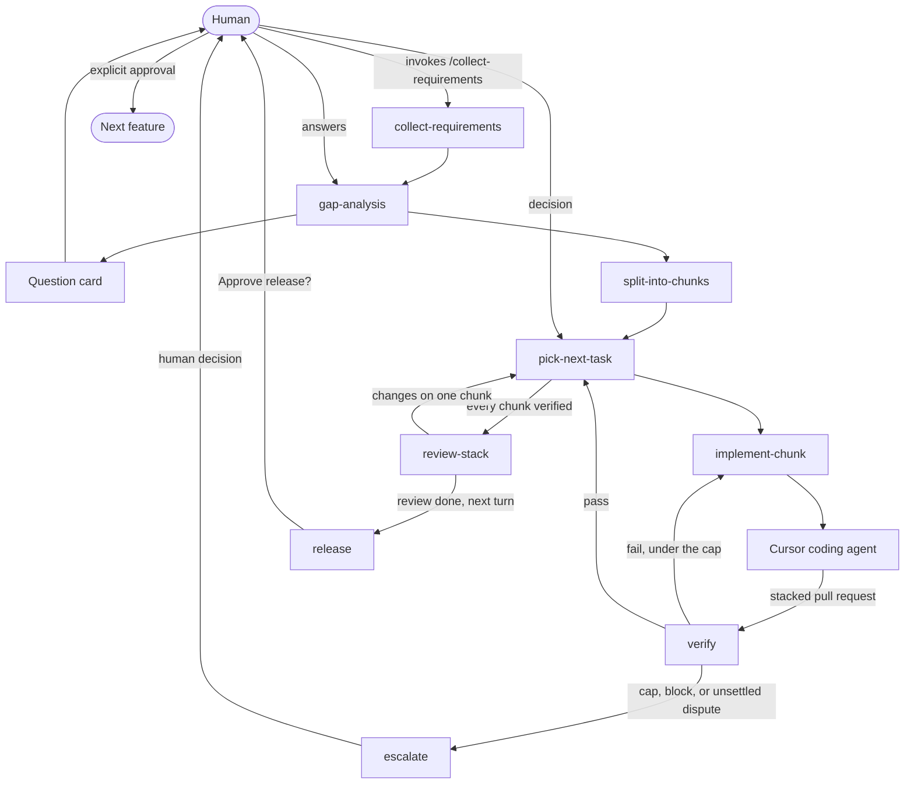

# fstack

fstack is a shareable Cursor plugin for a small team of agents that delivers one software feature end to end. The human starts requirements, reviews the stack once, and approves release. An orchestrator plans the work and launches Cursor coding agents. A verifier returns a verdict from the spec and the patch.

The name is short for feature stack. Coding runs in Cursor. Model names in the config are Cursor models. Legal statuses and transitions live in [`state/transitions.yaml`](state/transitions.yaml). Skills follow that table. There is no command-line runner.

## Install

This repository is the plugin. The Cursor manifest is `.cursor-plugin/plugin.json`. The root `plugin.json` is the Agent Plugins manifest, so the skills also load in hosts that follow that standard. Rules and agents are Cursor plugin components.

Local install:

1. Copy this repository to `~/.cursor/plugins/local/fstack`. Cursor skips a symlink that points outside that folder, so copy the files.
2. Reload the window.
3. Open Customize and confirm the fstack skills, the orchestrator, verifier, and advisor agents, and the human-gates rule.

From a team marketplace, install **fstack** from Customize after an admin imports this repository. Publishing to the public Cursor marketplace is a separate submission at [cursor.com/marketplace/publish](https://cursor.com/marketplace/publish). This repo stays a single plugin at the root, with no marketplace manifest, until an import shows that one is required.

## Quick start

In the product repository, with the plugin installed:

1. Invoke `/setup-project`. This writes `fstack.yaml` when it is missing, copies templates to `.fstack/templates/`, and writes resolved model names to `.fstack/resolved.yaml`.
2. Invoke `/collect-requirements` and describe the feature. Confirm the requirements file when asked. This is the only way requirements collection starts.
3. Answer the question card from gap analysis. If nothing is open, the orchestrator says so and continues.
4. The orchestrator splits the feature into stacked chunks. Plan approval waits only when `plan_review` is `approve`. The shipped value is `notify`, so coding starts after the plan is shown.
5. Each chunk is implemented by a Cursor coding agent and checked by a separate verifier. A repeated failure, a block, or an unsettled dispute stops for you.
6. Review the stacked pull requests when asked. That question does not approve release.
7. Answer the later release question. The stack is merged only after you explicitly approve the effect and the shas that question names.
8. After release, the orchestrator moves to the next open feature. A new feature still starts with `/collect-requirements`.

A later session resumes with `/fstack-status` and the feature slug.

## Flow



`build-context` writes `prompts/<chunk-id>/a<attempt>/<action>.md` before each action. The orchestrator builds the verify prompt from `git diff <base_sha>...<head_sha>`. That prompt includes the spec, the acceptance criteria, the out-of-scope section, and the patch. It does not include the feature directory, a pull request URL, or implementer notes. The verifier runs in a clean checkout of that head.

`tldr` rewrites messages to the human. Question ids, options, the release command, shas, and pull request URLs stay verbatim.

`planner_review` critiques gap analysis and the chunk split. `verify_tiebreak` critiques one disputed attempt. Both are read-only. A feature allows six advisor calls, and two of those are reserved for the tie-break. The tie-break is advice. The orchestrator decides or escalates.

## Configuration

`fstack.yaml` sits at the product repository root. Paths inside it are relative. Resolved Cursor slugs are written to `.fstack/resolved.yaml`, which is gitignored, so two people do not overwrite the shared file.

| Key | Shipped value | Meaning |
| --- | --- | --- |
| `state.backend` | `git` | Feature state lives on `fstack/<feature>/state` |
| `plan_review` | `notify` | Show the plan and continue. `approve` waits for a yes |
| `review.mode` | `end_of_stack` | One human review for the stack, then one release question |
| `verify.max_failures_before_escalation` | `2` | Counted with `attempts_since_decision`, using `>=` |
| `release.command` | empty | An approved release merges the stack and stops |

`models.opus` and `models.argon` are match prefixes and an effort list, in preference order. setup walks that list against the slugs this Cursor session can use. A missing family becomes `inherit`, the parent Cursor model.

The advisor block keeps the original fields and adds a fallback:

```yaml
advisors:
  planner_review:
    model: opus        # e.g. Claude Opus 5.5 in Cursor
    when: [gap-analysis, split-into-chunks]
  verify_tiebreak:
    model: argon       # Gemini 4 Argon in Cursor
    when: [verifier-disputed]
    fallback: [opus]
    must_differ_from: verifier
  max_calls_per_feature: 6
  reserve:
    verify_tiebreak: 2
```

If the tie-break would use the same model as the verifier, including when both are `inherit`, the orchestrator skips it and asks the human.

Human gates stay fixed: merge, release, and outward messages `require_approval`, and `collect_requirements` `manual_only`. setup stops when a config weakens them. Only a human quote of yes, approve, or approved counts, and only for the question id that was asked.

Roles name an agent and a model. They do not list skills. The agent file is the skill list. The parent that launches a subagent passes the model from `.fstack/resolved.yaml`.

`implementer.runtime` ships as `cloud`. setup sets `local_worktree` in the resolved file when this session cannot start a cloud agent that opens a pull request onto a non-default base, and it tells the human. A local implementer uses its own worktree.

## Workspace

```
features/<name>/
  feature.yaml
  requirements.md
  questions.md
  plan.md
  decisions.md
  advisors.md
  events/<nnnn>-<event>.yaml
  chunks/<NN-slug>.md
  prompts/<NN-slug>/a<attempt>/<action>.md
  verification/<NN-slug>/a<attempt>.yaml
  diffs/<NN-slug>/a<attempt>.diff
```

On the git backend those files live in a worktree of `fstack/<name>/state` at `.fstack-worktrees/<name>/`. Chunk branches do not contain them. The local backend uses `.fstack/local/<name>/` and stays on one machine.

Chunk frontmatter is the source of truth for status, branch, allowed files, and shas. The body is the spec, the acceptance criteria, and the out-of-scope section. Implementer notes stay in the pull request, under that heading, and the verify prompt omits them.

A chunk id is `NN-slug`. Status values and the events that change them are only those in [`state/transitions.yaml`](state/transitions.yaml).

## Skills

| Skill | Who invokes it | What it does |
| --- | --- | --- |
| `setup-project` | Human, or the orchestrator when config is missing | Copies templates, resolves models, records runtime |
| `collect-requirements` | Human, `/collect-requirements` only | Writes the requirements file, then hands off to the orchestrator |
| `gap-analysis` | Orchestrator | Sends a question card, or records that nothing is open |
| `split-into-chunks` | Orchestrator | Writes the stack and follows `plan_review` |
| `pick-next-task` | Orchestrator | Applies the next-rule list once |
| `implement-chunk` | Orchestrator | Hands off one chunk and records the agent id first |
| `verify` | Verifier | Returns a structured verdict and does not write state |
| `build-context` | Orchestrator, before an action | Writes the per-attempt prompt |
| `tldr` | Before a human-facing message | Short prose, verbatim decisions |
| `advisors` | Gap analysis, split, one dispute per attempt | Read-only critique, reserved tie-break budget |
| `escalate` | Orchestrator | Stops for retry, accept, a spec change, or stop |
| `review-stack` | Orchestrator, after every chunk is verified | Asks for review and waits |
| `release` | Orchestrator, after review | Asks, then merges only the approved shas |
| `fstack-status` | Human or a fresh session | Reads saved state and routes a reply |

## What is not enforced yet

[stubs/enforcement.md](stubs/enforcement.md) describes the approval record, the merge and release steps, and a shell hook that should refuse a merge without a matching approval. None of that runs. The release skill is the procedure the orchestrator follows by hand. `hooks.json` is absent so a stub is not loaded as if it enforced the gate.

## Adding a bot or a skill

Add a skill by creating `skills/<name>/SKILL.md`. The frontmatter `name` matches the folder. `description` says what it does and when to use it. Set `disable-model-invocation: true` when it must run only from an explicit `/` invocation.

Add a bot by creating `agents/<name>.md` with `name` and `description`, then a `roles` entry in `fstack.yaml` with `agent` and `model`. Put the skills it follows in the agent file. A read-only plugin agent sets `permissionMode: readonly`. When the bot needs a prompt, add `templates/prompts/<action>.md` and name the action in `build-context`. New statuses and events go in `state/transitions.yaml` first.

Run `python3 scripts/validate_plugin.py` after the edit. It checks the manifest, the transition table, the config, the template tokens, and that each event is named by its skill.

## License

MIT. See [LICENSE](LICENSE).
